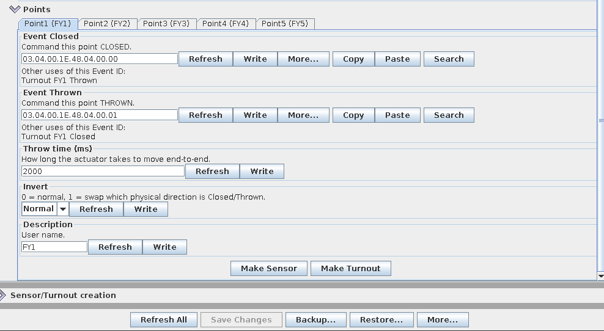

# lcc-railpoint

LCC / OpenLCB firmware that drives **MTB MP1** motorised point machines from a
**Seeed XIAO ESP32-S3** through **DRV8871** H-bridges, as ordinary JMRI turnouts.

It is a **WiFi node**: there is no CAN hardware. The node joins your WiFi and
connects to JMRI's OpenLCB hub over TCP (GridConnect), so it is on the same LCC
network as your CAN nodes, with JMRI forwarding between the two.

- One DRV8871 per point. A thrown/closed event drives the motor for `throwMs`
  (default 2 s), then lets it coast – the MP1's own end-stop cuts the current.
- **Frog polarity** comes from the MP1's own changeover contact – no GPIO or relay.
- **5 points**: 3 on native GPIO plus 2 on an MCP23017 I²C expander.
- Per point, set from JMRI's node configuration (CDI): closed/thrown events,
  `throwMs`, invert, and a description.
- Remembers each point's position across power cycles, and asks the network for
  the current state at start-up so it stays in step with JMRI.
- WiFi set-up through a captive portal (no credentials in the code); WiFi
  firmware updates (OTA).

## Hardware

- Seeed **XIAO ESP32-S3** with its **u.FL WiFi antenna fitted** (it barely
  connects without it).
- One **DRV8871** module per point (the genuine ones have exactly six pins:
  VM, GND, IN1, IN2, OUT1, OUT2). Cheap multipacks often include dead modules –
  if a point won't move, swap the module before debugging the wiring.
- **MCP23017** module for points 4 and 5 (address `0x20`: A0–A2 to GND).
- 12 V supply for the point motors, and 5 V (USB-C, or a buck converter from the
  12 V) for the XIAO. **Common ground** between everything.

### Wiring per point

The MP1 is a three-wire machine: `COM`, `POZ1`, `POZ2`, plus one changeover
contact for the frog.

| From | To |
|------|----|
| +12 V | DRV8871 VM **and** MP1 `COM` |
| 0 V | DRV8871 GND (and XIAO GND) |
| DRV8871 OUT1 / OUT2 | MP1 `POZ1` / `POZ2` |
| XIAO pin (table below) | DRV8871 IN1 / IN2 |
| MP1 changeover contact | frog and the two rail feeds (fit a resettable fuse in the frog feed – the MP1 v2 contact has no current limit) |

If a point moves the wrong way, either swap OUT1/OUT2 or set **Invert** for it in
the CDI.

### Pin map (`POINT_PINS` in `src/main.cpp`)

| Point | IN1 | IN2 | On |
|-------|-----|-----|----|
| 1 | D1 (GPIO2) | D3 (GPIO4) | XIAO |
| 2 | D8 (GPIO7) | D9 (GPIO8) | XIAO |
| 3 | D10 (GPIO9) | D0 (GPIO1) | XIAO |
| 4 | GPA0 | GPA1 | MCP23017 |
| 5 | GPA2 | GPA3 | MCP23017 |

MCP23017: SDA = D4 (GPIO5), SCL = D5 (GPIO6), VCC 3.3 V. The pull-ups on a
typical MCP23017 module are enough. Spare XIAO pins: D6/D7 (UART) and D2
(a strapping pin – avoid).

All DRV8871 inputs are driven low at the very start of `setup()`, so points
don't twitch while the node boots.

## Build and install

Uses PlatformIO with `espressif32@6.9.0` (arduino-esp32 2.0.x) and
**OpenMRNLite v2.0.0**.

1. **Set two values** at the top of `src/main.cpp` (the "SET THESE FOR YOUR
   LAYOUT" block):
   - `NODE_ID` – a node ID from **your own** range. The one in the file is
     mine; two nodes with the same ID break the network. (MERG members:
     `03.04.00.<membership number in hex>.<nn>`; otherwise get a free range
     from OpenLCB.)
   - `HUB_HOST` / `HUB_PORT` – the address of the computer running JMRI, port
     `12021` by default.
2. **In JMRI**, start the hub: **OpenLCB menu → Start Hub**.
3. **First flash over USB.** The XIAO-S3 needs download mode: hold **BOOT**, tap
   **RESET**, release **BOOT**, then:
   ```bash
   pio run -e xiao_s3_wifi -t upload
   ```
4. **Join your WiFi.** On first boot the node opens a WiFi access point called
   **`lcc-railpoint-Setup`** for 3 minutes. Connect from a phone, pick your
   network and enter the password. (No credentials saved and the portal timed
   out? Power-cycle to try again.)
5. The node connects to the JMRI hub and appears in **OpenLCB → Open LccPro**
   (or **Configure Nodes**) as "LCC RailPoint".
6. **Create the turnouts** in JMRI, one per point. A JMRI OpenLCB turnout's
   system name lists the **thrown** event first: `M2T<thrown event>;<closed event>`.
   The default events come from the node ID: point 1 = `…00` closed / `…01`
   thrown, point 2 = `…02` / `…03`, and so on – so point 1 is
   `M2T<node id>.00.01;<node id>.00.00`. To check, open the point's tab in the
   node configuration: under **Event Closed**, "Other uses of this Event ID"
   should say *Turnout … Closed*.
7. Adjust the throw time, Invert and description per point:

   

**Later updates go over WiFi:**

```bash
pio run -e xiao_s3_wifi_ota -t upload --upload-port <node-ip>
```

Use the IP address, not a `.local` name. ArduinoOTA has **no password**
in this build – add `ArduinoOTA.setPassword()` in `main.cpp` if your WiFi isn't
trusted.

### OpenMRNLite 2.0.0 patch for the ESP32-S3

OpenMRNLite 2.0.0 has a stray bracket in `Esp32Gpio.hxx` that breaks any
ESP32-S3 build with octal PSRAM enabled (PlatformIO's XIAO board definition
enables it). `patch_openmrnlite.py` runs automatically before each build and
fixes the downloaded library in place, so nothing manual is needed – but it's
worth knowing about if you start your own S3 project.

### Building with the Arduino IDE instead

The project is set up for PlatformIO, but builds in the Arduino IDE (or
arduino-cli) too. The versions matter – **OpenMRNLite 2.0.0 needs the ESP32
core 2.0.x**; OpenMRNLite 2.2.x needs core 3.x and won't build this sketch.

1. **Boards Manager:** install **esp32 by Espressif, version 2.0.17** (not 3.x).
2. **Library Manager:** install **OpenMRNLite, version 2.0.0** (pick it from the
   version dropdown) and **WiFiManager by tzapu**. If 2.0.0 isn't offered,
   download the zip from the
   [OpenMRNLite v2.0.0 release](https://github.com/openmrn/OpenMRNLite/releases/tag/v2.0.0)
   and use *Sketch → Include Library → Add .ZIP Library*.
   The IDE has one shared libraries folder, so this sets OpenMRNLite 2.0.0 for
   **every** sketch.
3. **Switch the compiler to C++17.** The code needs it (PlatformIO sets it in
   `platformio.ini`), but core 2.0.17 compiles with C++11 and fails with
   "use of deleted function" errors. Create a file called `platform.local.txt`
   next to the core's `platform.txt` – on Linux
   `~/.arduino15/packages/esp32/hardware/esp32/2.0.17/`, on Windows
   `%LOCALAPPDATA%\Arduino15\packages\esp32\hardware\esp32\2.0.17\`, on macOS
   `~/Library/Arduino15/packages/esp32/hardware/esp32/2.0.17/` – containing
   this one line, then restart the IDE:
   ```
   compiler.cpp.extra_flags=-std=gnu++17
   ```
   This applies to every sketch built with that core version.
4. **Make a sketch folder:** create a folder called `lcc-railpoint`, copy
   `src/main.cpp` into it renamed to **`lcc-railpoint.ino`**, and copy the other
   files from `src/` (`config.h`, `drv8871.h`, `mcp23017.cpp`, `mcp23017.h`)
   next to it.
5. **Tools menu:** Board **XIAO_ESP32S3**, and leave **PSRAM: Disabled** (the
   default – the node doesn't need it). The board's default 8 MB partition
   layout works; there's no partition setting to change.
   If you do enable **OPI PSRAM**, OpenMRNLite 2.0.0 fails to compile on a stray
   bracket – see the patch section below and make the same one-character fix
   by hand in your `libraries/OpenMRNLite/src/freertos_drivers/esp32/Esp32Gpio.hxx`.
6. First upload in download mode (hold BOOT, tap RESET, release BOOT). With
   arduino-cli you can pass the C++17 flag instead of step 3:
   ```bash
   arduino-cli compile -u -p /dev/ttyACM0 --fqbn esp32:esp32:XIAO_ESP32S3 \
     --build-property "compiler.cpp.extra_flags=-std=gnu++17" lcc-railpoint
   ```

An Arduino IDE build uses a different flash layout from the PlatformIO build, so
moving a node from one to the other wipes its stored configuration – re-enter it
in JMRI afterwards.

Tested with arduino-cli: esp32 core 2.0.17, OpenMRNLite 2.0.0, WiFiManager 2.0.17.

## Limits and findings

- **Five points is the tested maximum on WiFi.** The 5-point build has run on
  my layout since September 2026 without dropping its hub connection. An 8-point build (more
  MCP23017 points, and so a larger configuration) made the node reconnect every
  few moves. I haven't proven why. That attempt is kept under the tag
  `mcp-8point`; on a CAN connection it may well be fine.
- No position feedback: the MP1 has one changeover contact, used here for the
  frog, so the node reports the *commanded* position.
- A build with only the three native points and no MCP23017 is under the tag
  `native-3point`.

## Licence

MIT – see `LICENSE`. Parts are based on the ESP32IOBoard example from
OpenMRNLite by Mike Dunston (BSD 2-Clause; see `THIRD_PARTY_NOTICES`).
